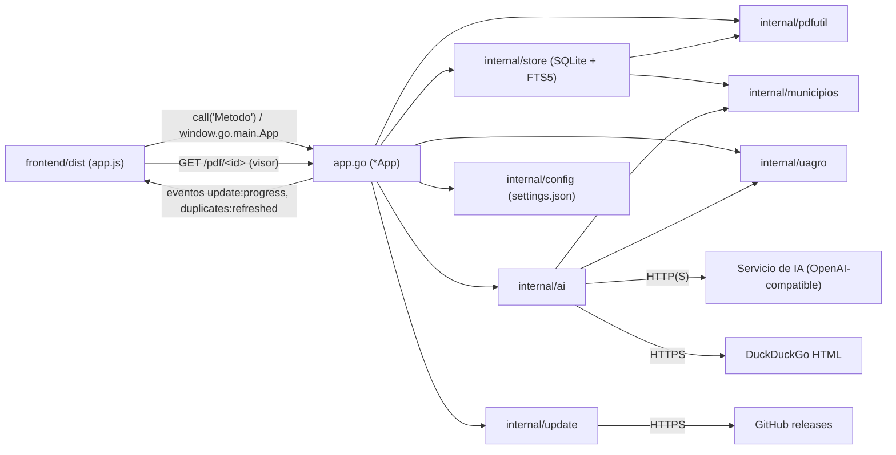

# Convenios UAGro Blueprint

## System Overview
Aplicación de escritorio para Windows (Go 1.26 + Wails v2, WebView2) que registra, busca, clasifica y descarga los convenios de la Universidad Autónoma de Guerrero. Se usa en **una sola PC**, por una persona. Todo se guarda en esa PC (`%APPDATA%\ConveniosUAGro\`): una base SQLite, los PDF y la configuración. No hay servidor propio ni sincronización entre equipos. El volumen actual es de unos 120 convenios y el objetivo es llegar al menos a 1000.

Flujo general: la interfaz (`frontend/dist`) llama a los métodos de `*App` en `app.go`. `app.go` coordina los paquetes de `internal/`: guarda en `store`, importa PDF con `pdfutil`, consulta la IA con `ai`, resuelve facultades con `uagro` y se actualiza con `update`. Para las páginas escaneadas, la interfaz dibuja cada página con PDF.js y la envía como JPEG; Go la manda al modelo de visión (`TranscribePage`) y guarda el texto. La revisión de lecturas dudosas (`VerifyAI`) funciona igual: la interfaz dibuja y Go consulta la IA.

## Local Interface & Invariants
Archivos de la raíz:
- `main.go`: arranque de Wails, candado de instancia única y errores fatales.
- `app.go`: la clase `App` que se publica a la interfaz.
- `instance_windows.go` / `instance_other.go`: candado de instancia y cuadros de diálogo nativos de Windows; fuera de Windows no hacen nada.
- `logfile.go`: log en archivo.

**Interface**
- **Instancia única.** Antes de abrir la base, `main` toma un mutex con nombre de Windows. Si otra ventana ya lo tiene, la trae al frente y sale. Con `--after-update` espera hasta 30 s a que la versión anterior lo suelte [main.go:main] [instance_windows.go:acquireInstance] [instance_windows.go:focusExisting]
- **Errores al abrir.** Un error al abrir la app (base de un esquema más nuevo, migración fallida) se registra y se muestra en un cuadro de diálogo nativo antes de salir [main.go:fatal] [instance_windows.go:showFatal]
- **`*App`.** `NewApp` crea una sola instancia de `*App`, que se pasa a `wails.Run` en `Bind`. Sus 49 métodos exportados son la API de la interfaz [main.go:main] [app.go:NewApp]
- **Ventana.** Se llama «Convenios UAGro», mide 1320×860 (mínimo 1040×680) y usa `OnStartup`, `OnShutdown` y el middleware del servidor de recursos. Soltar archivos sobre la ventana entrega las rutas a la interfaz [main.go:main]
- **Visor de PDF.** La ruta `GET /pdf/<id>` sirve el PDF guardado, solo con un id numérico, y responde 404 si el id no es válido o no existe [app.go:(*App).middleware]
- **Métodos publicados, por grupo:**
  - Arranque: `GetBootstrap`
  - Lista y ficha: `ListConvenios`, `GetConvenio`, `SaveConvenio`, `DeleteConvenios`, `SetNoConvenio`
  - Importación de PDF: `ChoosePDFs`, `CheckImport`, `ImportPDFs`
  - Etiquetas y sugerencias: `GetTags`, `CreateTag`, `UpdateTag`, `DeleteTag`, `SaveConvenioTags`, `AcceptSuggestions`, `DiscardSuggestions`
  - IA: `ExtractAI`, `PagesToVerify`, `VerifyAI`
  - Transcripción: `BeginTranscription`, `ResumeTranscription`, `TranscribePage`, `FinishTranscription`, `FailTranscription`, `GetTranscription`, `DownloadTranscription`
  - Reintentos: `RetryCandidates`, `RetryableError`
  - Archivados: `ArchiveConvenios`, `UnarchiveConvenios`
  - Descargas y exportación: `DownloadPDF`, `DownloadPDFs`, `DownloadPDFsFiltered`, `ExportConvenios`, `ExportConveniosCSV`, `BackupData`
  - Paquetes: `ChooseImportFile`, `ImportConvenios`
  - Duplicados y versiones: `ListDuplicates`, `DismissDuplicate`, `LinkVersion`, `UnlinkVersion`
  - Ajustes: `GetSettings`, `SaveSettings`, `OpenDataFolder`
  - Actualización: `CheckUpdate`, `ApplyUpdate`, `OpenReleasePage`
  - Diagnóstico: `Health`

  [app.go:(*App).GetBootstrap] [app.go:(*App).DeleteConvenios] [app.go:(*App).DownloadTranscription]
- **Tipos de respuesta propios:**
  - `Bootstrap`: etiquetas, contadores, datos de la app, ajustes y un `aviso` del arranque que se entrega una sola vez
  - `ImportResult`: ruta, id, nombre, error, `duplicate_id` y `cloned`
  - `ImportCheck`: ruta, nombre, duplicado en la base, `repetido` dentro de la misma selección y error
  - `ExportResult`: ruta y total
  - `PageImage`: número de página e imagen en base64

  [app.go:Bootstrap] [app.go:ImportResult] [app.go:ImportCheck] [app.go:ExportResult] [app.go:PageImage]
- **Métodos sin uso en la interfaz.** `app.js` usa 46 de los 49 métodos. `GetSettings`, `GetTags` y `Health` están publicados pero nadie los llama, ni siquiera las pruebas; `Health` además devuelve la ruta de datos [app.go:(*App).Health] [app.go:(*App).GetTags] [app.go:(*App).GetSettings]
- **Eventos hacia la interfaz:**
  - `duplicates:refreshed`: se emite tras recalcular los duplicados al arrancar, aunque el recálculo falle.
  - `update:progress`: se emite durante la descarga, solo cuando cambia el porcentaje entero.

  [app.go:(*App).startup] [app.go:(*App).ApplyUpdate]
- **Versión.** Está en `appVersion`; `buildCommit` y `buildDate` se fijan al compilar con `-ldflags -X` [app.go:appVersion] [app.go:buildCommit]

**Invariants**
- **Topes por llamada.** Los que pasan el límite se descartan sin aviso.
  - `ImportPDFs`: 60 rutas.
  - `DeleteConvenios`: 200 ids.
  - `ArchiveConvenios` y `UnarchiveConvenios`: 500 ids.

  Desde la interfaz no se alcanzan, porque la selección es por página (40) [app.go:(*App).ImportPDFs] [internal/store/conventions.go:maxBulkDelete] [internal/store/archive.go:maxBulkArchive]
- **`DeleteConvenios` es definitivo.** Borra las filas y sus PDF, sin papelera. Si falla el borrado de un archivo, ese PDF queda huérfano sin aviso [app.go:(*App).DeleteConvenios]
- **`DownloadPDFs` puede salir bien a medias.** Informa éxito si guardó al menos un archivo, aunque otros fallen, y solo da error si no guardó ninguno [app.go:(*App).DownloadPDFs]
- **Diálogos.** Los métodos que abren diálogos fallan con «la aplicación aún no está lista» mientras no exista el contexto de Wails. Cancelar un diálogo no es un error: devuelve `""` o `ExportResult{}` con `err == nil` [app.go:(*App).ChoosePDFs] [app.go:(*App).BackupData]
- **Extensión agregada.** Si el nombre elegido no trae la extensión, se agrega. Si ya existe un archivo con ese nombre completo, la operación falla en lugar de reemplazarlo sin confirmación [app.go:withExtension]
- **Requisitos de la IA.** Toda operación de IA exige la IA activada y una clave guardada. `RetryCandidates` devuelve una lista vacía en vez de fallar [app.go:(*App).extract] [app.go:(*App).RetryCandidates]
- **Reintentos.** Si un error se reintenta o no se decide por el texto del mensaje (`RetryableError`): son permanentes los que contienen «active el análisis», «configure una clave», «configure y active» o «no tiene texto seleccionable», y algunos los escribe `app.js`. Esos textos son parte del contrato: cambiarlos cambia qué se reintenta. Cualquier otro error se reintenta, hasta 3 rondas (`MaxRetryRounds`) [internal/store/retry.go:RetryableError] [internal/store/retry.go:MaxRetryRounds]
- **Tiempos límite:**
  - Llamadas a la IA (extracción, verificación por página, transcripción): 300 s cada una.
  - Comprobación de actualizaciones: 2 peticiones de 30 s, con un máximo de 40 s en total.
  - Descarga de la actualización: 15 min por petición, con un máximo de 20 min.

  [app.go:(*App).extract] [app.go:(*App).CheckUpdate] [app.go:(*App).ApplyUpdate]
- **La IA reemplaza los datos.** `extract` sobrescribe todos los campos de la ficha, incluidas las notas, sin comparar versión. Si el usuario guarda la ficha mientras la IA trabaja, uno de los dos cambios se pierde [app.go:(*App).extract] [internal/store/conventions.go:SetAIResult]
- **Dudas de lectura:**
  - Viven solo en memoria y se pierden al cerrar la app.
  - Se revisan con la imagen una sola vez por extracción.
  - `PagesToVerify` devuelve como máximo 3 páginas, y solo páginas transcritas.
  - Con la IA apagada, `VerifyAI` falla y conserva las dudas.

  [app.go:(*App).takeDoubts] [app.go:(*App).PagesToVerify] [app.go:(*App).VerifyAI]
- **Candados.** Todos los cambios de etiquetas se hacen con `tagMu`: guardar la ficha, elegir etiquetas, aceptar o descartar sugerencias, aplicar la IA, crear, editar o borrar etiquetas, clonar un análisis, importar paquetes y las reparaciones del arranque. Los cambios de configuración usan `cfgMu`, y la configuración en memoria solo cambia si se guardó bien en disco. Ningún candado funciona entre procesos; por eso existe la instancia única [app.go:App.tagMu] [app.go:(*App).SaveSettings]
- **Facultad.** El campo Facultad define la etiqueta de tipo facultad:
  - Si se reconoce (catálogo de `uagro` o un texto que empieza con un tipo de unidad), la etiqueta es «<nombre> <sede>», o solo «<nombre>» cuando la sede no se puede saber.
  - Si queda vacío o no se reconoce, el convenio lleva «Convenio Abierto».
  - Cuando el texto del campo cambia, la etiqueta anterior se quita antes de aplicar la nueva.
  - Una facultad elegida a mano en las etiquetas se reemplaza por la que sale del campo, y las facultades que quedan sin uso se borran del catálogo.
  - Es de mejor esfuerzo: un error al aplicarla se ignora.

  [app.go:(*App).syncFacultyTag] [app.go:(*App).ensureFacultyTag] [internal/uagro/facultades.go:Resolve]
- **Rutas de descarga.** `DownloadPDFs` no reemplaza los archivos que ya estaban en la carpeta al empezar. No protege contra archivos que aparezcan durante la descarga [app.go:(*App).DownloadPDFs]
- **`ApplyUpdate`** no puede correr dos veces a la vez y se detiene si falla la copia de seguridad de la base [app.go:(*App).ApplyUpdate]
- **`OpenReleasePage`** abre la dirección solo si es del repositorio propio en GitHub (comparación por prefijo). Si no, abre la página de la versión más reciente. Nunca devuelve error [app.go:(*App).OpenReleasePage]
- **Frontera de confianza.** Todo lo que corre en la WebView puede llamar a los 49 métodos, incluidos `DeleteConvenios`, `SaveSettings` y `ApplyUpdate`. La interfaz escapa todo el texto con `esc()`, pero no hay `Content-Security-Policy` [frontend/dist/index.html:head]

## Subdirectories & System Boundaries
- frontend: [./frontend/EGM.md](./frontend/EGM.md) - Interfaz de escritorio escrita a mano (`frontend/dist`), incrustada en el ejecutable.
- internal: [./internal/EGM.md](./internal/EGM.md) - Paquetes Go: `store` (persistencia), `ai` (IA y búsqueda web), `pdfutil` (PDF), `config` (ajustes), `uagro` (facultades), `municipios` (nombres oficiales) y `update` (autoactualización).

## Global Invariants
- **Versión en tres lugares.** `VERSION`, `appVersion` en `app.go` y `productVersion` en `wails.json` deben coincidir. La prueba `TestVersionFilesMatch` lo exige y busca el texto exacto `"productVersion": "X"` [app_test.go:TestVersionFilesMatch]
- **Publicación:**
  - Solo el usuario sube a `main`, a través de Claude Code (deploy key de este equipo).
  - Cada push a `main` corre `go test`, compila con `wails build` y reemplaza el release `v<VERSION>`: primero lo borra y luego lo crea.
  - Las publicaciones van en fila (`cancel-in-progress: false`), así que no se cortan entre los dos pasos.
  - La app instalada se actualiza desde ese release: cualquier cambio en `main` llega a la PC.
  - La interfaz no tiene pruebas automatizadas, así que la única barrera para ella es la revisión antes del merge.

  [.github/workflows/release.yml:concurrency] [.github/workflows/release.yml:on.push.branches]
- **Cuándo hay versión nueva.** Un release cuenta como nuevo si su versión es mayor, o si tiene la misma versión con otro commit y una fecha de publicación posterior a `buildDate`. Una compilación local sin `-ldflags` nunca ve actualizaciones de su misma versión. Si GitHub no tiene release (404), `CheckUpdate` devuelve `ErrNoRelease` y la interfaz muestra «No se pudo revisar», no «Al día» [internal/update/update.go:isNewer] [internal/update/update.go:ErrNoRelease]
- **Sin vuelta atrás automática.** El `.old` se borra al arrancar la versión nueva y el release anterior de la misma `VERSION` desaparece. Para volver atrás hay que publicar una corrección o restaurar a mano la copia `antes-de-actualizar-*.db` [app.go:cleanupOldExecutable] [internal/update/update.go:Cleanup]
- **Esquema de la base: versión 7.** Una base de una versión más nueva no se abre; la app muestra el error y no arranca. Una base ya migrada no la abre una versión anterior [internal/store/store.go:schemaVersion]
- **Etiquetas.** Cada convenio lleva una sola etiqueta de ámbito, estado, ciudad y facultad. Una ciudad implica su estado y un estado de México implica «Nacional». Las ciudades usan el nombre oficial del municipio [internal/store/tags.go:consistentTags] [internal/municipios/municipios.go:Oficial]
- **Qué muestra la lista principal.** Por omisión, la lista, su buscador y sus contadores excluyen los archivados y las versiones anteriores. `ListFilter.IncluirAnteriores` muestra las anteriores y `ListFilter.Archivados` cambia a la vista de archivados [internal/store/conventions.go:List] [internal/store/conventions.go:Stats]
- **Clave de API:**
  - Se guarda en texto plano en `settings.json`.
  - En Windows, `Chmod(0600)` solo cambia el atributo de solo lectura: la protección real es la ACL del perfil en `%APPDATA%`.
  - La interfaz recibe `has_api_key` y una pista con los últimos 4 caracteres, nunca la clave completa.
  - `BaseURL` acepta `http://`. Al cambiarla, la clave guardada se conserva y se envía al nuevo servidor.

  [internal/config/config.go:Config.ToView] [internal/config/config.go:Apply]
- **Volumen.** `RefreshDuplicates` compara todos los pares (O(n²)) y reescribe la tabla de duplicados de forma síncrona tras casi cada cambio, sobre una sola conexión SQLite. Medido: unos 28 ms con 1000 convenios; la lista tarda unos 3 ms. Escala bien hasta unos pocos miles [internal/store/duplicates.go:RefreshDuplicates]

## Global Side Effects
- **Carpeta de datos.** Es `%APPDATA%\ConveniosUAGro\`, `os.UserConfigDir()` fuera de Windows, o `CONVENIOS_DATA_DIR`. Se crea al arrancar y contiene:
  - `convenios.db` (+ `-wal`, `-shm`) y `pdfs/`
  - `respaldos/`: respaldos manuales y copias `antes-de-actualizar-<ver>-<fecha>.db`
  - `settings.json` y su temporal `.settings-*.tmp`
  - `convenios.log` (se rota a `.log.1` al pasar de 1 MiB)

  [internal/store/store.go:DefaultPaths] [internal/config/config.go:Save] [logfile.go:setupLog]
- **Ajustes dañados.** Si `settings.json` no se puede leer, se aparta como `settings.json.danado-<fecha>`, se crean unos nuevos con los valores iniciales y la interfaz muestra el aviso al abrir. La clave hay que volver a capturarla [app.go:loadConfig]
- **Arranque, en orden:**
  - `store.Open` carga las etiquetas base, pasa a `pendiente` las transcripciones `en_proceso` y marca como error los análisis `pendiente` («Análisis interrumpido»).
  - `startup`, con `tagMu`, aplica las sugerencias pendientes, asigna el estado de las ciudades, unifica los nombres de municipio y repara las etiquetas de facultad. Corre una sola vez en la vida de la base, protegida por una bandera, la reparación de etiquetas obligatorias, y marca «Convenio Abierto» donde falta.
  - En segundo plano: el recálculo de duplicados y la limpieza del `.old` (hasta 10 intentos cada 2 s).
  - `ImportConvenios` repite, con `tagMu`, la unificación de municipios, la reparación de facultades y «Convenio Abierto».

  [internal/store/store.go:Open] [app.go:(*App).startup] [app.go:(*App).ImportConvenios]
- **Datos que salen de la PC, solo al usarse:**
  - Con la IA activa, el texto completo del convenio y las imágenes de las páginas escaneadas (con nombres y firmas) van al servicio de IA (`POST {BaseURL}/chat/completions`, DeepSeek por omisión).
  - La búsqueda web viene activada por omisión: manda a DuckDuckGo el nombre de la contraparte y su domicilio (máx. 220 caracteres, 20 s). Sus resultados entran al prompt; la validación contra el catálogo de etiquetas limita, pero no elimina, el riesgo de inyección.
  - A GitHub van 2 consultas anónimas al arrancar y cada 6 h. El límite es de 60 por hora por IP; con un 403 la interfaz muestra «No se pudo revisar».

  [internal/ai/ai.go:post] [internal/ai/websearch.go:fetchSearch] [internal/update/update.go:getJSON]
- **Actualización, en orden:**
  1. Copia la base a `respaldos/` con `VACUUM INTO`.
  2. Descarga el ejecutable y lo valida: tamaño entre 1 KiB y el máximo, SHA-256 de las notas del release o del `digest` del asset (si no hay ninguno, esa comprobación se omite) y cabecera `MZ`.
  3. Mueve el exe a `.old` y el `.new` al exe; si algo falla, deshace el cambio.
  4. Lanza `exe --after-update` y cierra la app a los 300 ms.

  El SHA-256 viaja en el mismo release que el binario: detecta corrupción, no manipulación. Las copias previas no se borran nunca y no incluyen los PDF [app.go:(*App).ApplyUpdate] [internal/update/update.go:Install]
- **Restaurar un respaldo** es manual (instrucciones en el LEEME del ZIP). Antes de copiar la base restaurada hay que borrar `convenios.db-wal` y `convenios.db-shm`, o SQLite podría reaplicar cambios viejos [internal/store/backup.go:BackupZip]
- **Programas del sistema.** Abre el explorador de archivos y el navegador a pedido del usuario [app.go:(*App).OpenDataFolder] [app.go:(*App).OpenReleasePage]

## System Verification
- Run: `go test ./...`
- La compilación para Windows se comprueba con `GOOS=windows go vet .`
- Run: `node --test frontend/tests/revision.test.js` (funciones puras de la revisión puntual; también corre en CI).
- El resto de la interfaz no tiene pruebas automatizadas: los cambios en `frontend/dist` se verifican a mano.
